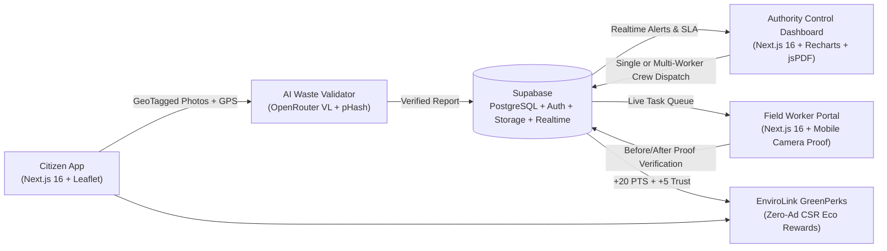

# EnviroLink 🌱

> **AI-powered civic waste reporting, municipal dispatch & eco-rewards ecosystem connecting citizens, field crews, and municipal authorities in real time.**

---

## 🌐 Live Production Portals

| Portal | Role | Live URL | Default Local Port |
| :--- | :--- | :--- | :--- |
| **Citizen Web App** | Citizens & community contributors | https://envirolink-citizen.vercel.app | `http://localhost:3000` |
| **Authority Dashboard** | Municipal admins & dispatchers | https://envirolink-admin.vercel.app | `http://localhost:3001` |
| **Field Worker Portal** | Sanitation crews & field responders | https://envirolink-worker.vercel.app | `http://localhost:3002` |

> **Suggested GitHub Repo Description:**
> `AI-powered civic waste management platform (Citizen + Authority + Field Worker). Live: https://envirolink-citizen.vercel.app | https://envirolink-admin.vercel.app | https://envirolink-worker.vercel.app`

---

## 🧭 System Architecture



---

## ✨ Core Features & Modules

### 1. Citizen App (`citizen-app/`)
- **Guided Waste Reporting (`/report`)**:
  - **12 Waste & Civic Hazard Categories**: Illegal Dumping, Overflowing Bin, Littering, Construction Debris, E-Waste, Organic Waste, Sewage Overflow, Dead Animal, Burning Waste, Abandoned Vehicle, Hazardous Material, and Electrical Hazard.
  - **Built-In Live GeoTag Camera (`GeoTagCameraModal`) + Gallery Fallback**: Captures live camera photos (`<video>` stream) or reads existing gallery photos with **native EXIF GPS extraction**, automatically stamping crisp location, coordinates, address, and IST/local timestamp onto uploaded images ([geotag.ts](file:///d:/ANTIGRAVITY%20PROJECTS/EnviroLink/citizen-app/src/lib/geotag.ts)).
  - **AI Vision Validation (`/api/analyze-image`)**: Validates uploaded images with `nvidia/nemotron-3.5-super-vl:free` via OpenRouter (rejecting screenshots, memes, clean scenes, or portraits) and suggests categories & confidence scores.
  - **Voice Input (`/api/speech-to-text`) & Reverse Geocoding (`/api/geocode`)**: Multi-lingual voice notes and Nominatim address lookup.
- **Anti-Fraud & Trust Score Engine**:
  - Perceptual duplicate image hash matching + `75m` nearby-report deduplication window.
  - Citizen accounts accumulate **+20 Civic Points** & **+5 Trust Score** once a report is verified and resolved, while rejected/false reports deduct **-25 Trust Score**.
- **Interactive Live Map (`/map`) & Detail Inspection**:
  - React-Leaflet / OpenStreetMap map with **auto `fitBounds`** across all reported hotspots, interactive Zoom In/Out, Street vs. Clean Light (`CARTO`) layer switcher, GPS Locate Me, category/status filtering, Supabase Realtime updates, `localStorage` SWR instant hydration, and rich **ReportDetailModal** progress timelines.
- **Per-Account Isolated Profile (`/profile`) & Google OAuth**:
  - Persistent Google OAuth & email/password sessions via `@supabase/ssr` with fast non-blocking cookie hydration, per-account `localStorage` report isolation (`envirolink_my_report_ids:<userId>`), inline name editing, and one-click Report ID lookup.
- **EnviroLink GreenPerks 🌱 (`/perks`)**:
  - Non-intrusive, zero-ad monetization showcase enabling citizens to redeem verified cleanup points (`PTS`) for eco-friendly products, composting kits, indoor plants, recycled stationery, and sustainable brand vouchers.
  - Features real brand partner logos (**Beco**, **The Better Home**, **Phool**, **Bisleri Bottles for Change**, **Ugaoo**, **Daily Dump**), a sponsored **30-Day Clean Neighbourhood Challenge**, an **"Expo Demo Balance (120 PTS)"** presentation toggle, and an animated **Eco-Voucher Pass** generator.

### 2. Authority Control Dashboard (`authority-dashboard/`)
- **Executive Operations Overview (`/`)**: Live report counters, SLA breach tracking, severity breakdown charts (`Recharts`), interactive heatmap/marker map, and one-click Executive Summary PDF export.
- **Reports Management & Multi-Worker Crew Dispatch (`/reports`)**:
  - Real-time table with status filters (`All`, `Submitted`, `Assigned`, `In Progress`, `Resolved`, `Rejected`), advanced category/severity/date/SLA filtering, full photo evidence comparison (`Citizen GeoTag` vs `Worker GeoTag Proof`), bulk resolution/deletion, and **animated Worker / Crew multi-select assignment modal** (`Lead` + `Crew #N`).
- **AI Assignment & Backup Coordination (`/assignment`)**:
  - Severity-aware automated dispatch (auto-assigns 2-worker crews for High/Critical incidents when available) and live handling of **Backup Crew Requests** escalated from field workers on site.
- **Full-Bleed Landscape Operations PDF Reports (`lib/pdfExport.ts`)**:
  - Pixel-aligned 269 mm landscape A4 tables via `jsPDF` + `jspdf-autotable` with balanced 4-card KPI strips, color-coded severity/SLA indicators, repeating headers, and multi-page footers.
- **Workforce Onboarding (`/workers`, `/workers/pending`) & Analytics (`/analytics`)**: Approve/reject worker registrations and inspect municipal resolution trends.

### 3. Field Worker Portal (`worker-portal/`)
- **Mobile-First Assigned Task Dashboard (`/`)**:
  - Single-query batched task & image loading supporting both solo assignments and shared multi-worker crew jobs (`crew:<ids>` protocol in `lib/crew.ts`).
  - **Live GeoTagged Completion Camera & AI Proof Check (`/api/verify-completion`)**: Field workers capture post-cleanup GeoTagged photos verified before marking tasks `resolved`.
  - **Request Backup Crew & Fake Report Escalation**: Workers overwhelmed by heavy dumps can request `+N` backup crew members (`Backup Requested (+N) · reason`) or flag non-existent waste (`rejected`) with photo proof.
- **Route Map (`/map`), Earnings (`/earnings`), Notifications (`/notifications`), Profile (`/profile`)**: Integrated Google Maps turn-by-turn deep links, severity-based payout summaries, and worker approval gating.

---

## 🛠️ Tech Stack

| Layer | Technologies |
| :--- | :--- |
| **Framework** | Next.js `16.1.1` (App Router + Turbopack), React `19.2.3`, TypeScript `5` |
| **Styling & Motion** | Tailwind CSS v4 (`@tailwindcss/postcss`), Framer Motion `12.x`, Nunito & Inter typography |
| **State & Charts** | Zustand `5.x`, Recharts `3.x`, Lucide React |
| **Database, Auth & Storage** | Supabase (`@supabase/supabase-js`, `@supabase/ssr`) — PostgreSQL, GoTrue OAuth, Storage (`report-images`), Realtime |
| **Mapping & Geolocation** | Leaflet `1.9.4`, React-Leaflet `5.x`, OpenStreetMap & CARTO tiles, Nominatim Reverse Geocoding, Client EXIF GPS parser |
| **AI & Reporting** | OpenRouter Vision (`nvidia/nemotron-3.5-super-vl:free`), Groq/Gemini fallbacks, `jsPDF` `3.x`, `jspdf-autotable` `5.x` |

---

## 📁 Repository Structure

```text
EnviroLink/
├── citizen-app/                 # Citizen web portal (Port 3000)
│   ├── public/images/
│   │   ├── perks/               # Local GreenPerks product studio thumbnails
│   │   └── partners/            # Official partner logos (Beco, Phool, Ugaoo, etc.)
│   └── src/
│       ├── app/                 # Routes: /home, /map, /report, /profile, /perks, /login, /api/*
│       ├── components/          # GeoTagCameraModal, LeafletMap, ReportDetailModal, Navbar, Providers
│       ├── lib/                 # supabase.ts (lock-free), geotag.ts, greenperks.ts
│       └── store/               # Zustand app store (auth hydration + embedded REST queries)
├── authority-dashboard/         # Municipal authority dashboard (Port 3001)
│   └── src/
│       ├── app/                 # Routes: /, /reports, /assignment, /map, /workers, /analytics, /login
│       ├── components/          # Sidebar, LeafletMap, FloatingBlobs, BootAppWrapper
│       └── lib/                 # supabase.ts, crew.ts, pdfExport.ts
├── worker-portal/               # Sanitation worker portal (Port 3002)
│   └── src/
│       ├── app/                 # Routes: /, /map, /earnings, /notifications, /profile, /login, /register
│       ├── components/          # GeoTagCameraModal, LeafletMap, BottomNav
│       └── lib/                 # supabase.ts, crew.ts, geotag.ts
└── docs/                        # Architectural guides & full system specification
```

---

## ⚙️ Environment Setup

Create `.env.local` inside **`citizen-app/`**, **`authority-dashboard/`**, and **`worker-portal/`**:

```env
# Required across all 3 portals
NEXT_PUBLIC_SUPABASE_URL=https://your-project-id.supabase.co
NEXT_PUBLIC_SUPABASE_ANON_KEY=your-supabase-anon-key

# Citizen App AI Image & Voice APIs (citizen-app/.env.local)
OPENROUTER_API_KEY=your-openrouter-api-key
GROQ_API_KEY=your-groq-api-key

# Worker Portal AI Proof Verification (worker-portal/.env.local)
OPENROUTER_API_KEY=your-openrouter-api-key
```

Also see [`citizen-app/SUPABASE_SETUP.md`](./citizen-app/SUPABASE_SETUP.md) for creating the `report-images` storage bucket and enabling Auth providers.

---

## 🚀 Running Locally

Install dependencies and start each portal in its own terminal:

```bash
# 1. Citizen App (http://localhost:3000)
cd citizen-app
npm install
npm run dev -- -p 3000

# 2. Authority Dashboard (http://localhost:3001)
cd authority-dashboard
npm install
npm run dev -- -p 3001

# 3. Field Worker Portal (http://localhost:3002)
cd worker-portal
npm install
npm run dev -- -p 3002
```

### Type-Checking & Production Builds

```bash
# Run in any portal directory (citizen-app / authority-dashboard / worker-portal)
npx tsc --noEmit && npm run build
```

---

## 📚 Additional Documentation

- [`docs/README.md`](./docs/README.md) — Documentation hub & platform overview
- [`docs/SYSTEM_SPECIFICATION.md`](./docs/SYSTEM_SPECIFICATION.md) — Full architecture, database tables, crew protocol, AI validation, lock-free Supabase strategy, and GreenPerks design

---

## 📄 License

Licensed under the **MIT License**.
