# EnviroLink Platform — Complete System Specification 🌱

> **Vision:** *"Turn every citizen into a cleanliness sensor and every municipal team into a fast, verified responder."*

---

## Table of Contents

1. [System Architecture & Live Deployments](#1-system-architecture--live-deployments)
2. [Three-Portal Frontend Applications](#2-three-portal-frontend-applications)
3. [Backend Data Model (Supabase PostgreSQL & Storage)](#3-backend-data-model-supabase-postgresql--storage)
4. [Next.js API Routes Specification](#4-nextjs-api-routes-specification)
5. [GeoTagging, AI Validation & Anti-Fraud Engine](#5-geotagging-ai-validation--anti-fraud-engine)
6. [Multi-Worker Crew Dispatch & Field Escalation Protocol](#6-multi-worker-crew-dispatch--field-escalation-protocol)
7. [Lock-Free Auth Hydration & High-Speed Query Layer](#7-lock-free-auth-hydration--high-speed-query-layer)
8. [EnviroLink GreenPerks (Zero-Ad Monetization)](#8-envirolink-greenperks-zero-ad-monetization)
9. [Municipal PDF Reporting & Analytics](#9-municipal-pdf-reporting--analytics)
10. [Deployment & Android Companion Packaging](#10-deployment--android-companion-packaging)

---

## 1. System Architecture & Live Deployments

EnviroLink is structured as a three-application Next.js (`16.1.1`) + Supabase architecture deployed on Vercel:

| Service / App | Directory | Live URL | Primary Users |
| :--- | :--- | :--- | :--- |
| **Citizen Portal** | `citizen-app/` | https://envirolink-citizen.vercel.app | Citizens, resident volunteers |
| **Authority Control Dashboard** | `authority-dashboard/` | https://envirolink-admin.vercel.app | Municipal commissioners & dispatchers |
| **Field Worker Portal** | `worker-portal/` | https://envirolink-worker.vercel.app | Approved sanitation staff & cleanup crews |

```mermaid
flowchart TB
    subgraph Citizens["Citizen Ecosystem"]
        CA["citizen-app (Next.js 16)\n/home · /map · /report · /profile · /perks"]
        CAM["GeoTagCameraModal + EXIF GPS\nCanvas Stamp + Perceptual Hash"]
        CA --> CAM
    end

    subgraph Authorities["Authority Ecosystem"]
        AD["authority-dashboard (Next.js 16)\n/ · /reports · /assignment · /map · /workers · /analytics"]
        PDF["jsPDF + autoTable\n269mm Landscape KPI Reports"]
        AD --> PDF
    end

    subgraph Workers["Field Operations Ecosystem"]
        WP["worker-portal (Next.js 16)\n/ · /map · /earnings · /notifications · /profile"]
        WC["Worker GeoTag Proof + Backup Escalation"]
        WP --> WC
    end

    subgraph APIs["Serverless Route Handlers"]
        AI1["/api/analyze-image\n(OpenRouter Nemotron VL)"]
        AI2["/api/verify-completion\n(Before/After Proof Check)"]
        GEO["/api/geocode\n(Nominatim Reverse Geocode)"]
        STT["/api/speech-to-text\n(Voice Description Transcription)"]
    end

    subgraph Supabase["Supabase Cloud Backend"]
        AUTH["GoTrue Auth (Google OAuth + Email)"]
        PG[("PostgreSQL\nreports · report_images · profiles · workers")]
        ST["Storage Bucket\nreport-images (Public Read)"]
        RT["Realtime Channel\npostgres_changes on reports"]
    end

    CA --> AI1 & GEO & STT
    WP --> AI2
    CA <--> AUTH & PG & ST & RT
    AD <--> PG & ST & RT
    WP <--> AUTH & PG & ST & RT
```

---

## 2. Three-Portal Frontend Applications

### 2.1 Citizen App (`citizen-app/`)

| Route | Purpose | Key Behaviour |
| :--- | :--- | :--- |
| `/home` | Landing overview & live city pulse | Hero metrics, live Leaflet preview map (`fitBounds`), recent community reports, instant `localStorage` cache hydration. |
| `/report` | 5-step GeoTagged report wizard | Supports camera capture & gallery uploads (with EXIF GPS fallback), 12 waste/hazard categories, severity selection, AI auto-categorization, voice notes, duplicate check. |
| `/map` | Live interactive waste hotspot map | Auto-fetches & subscribes to Supabase Realtime, Street / CARTO Clean Light layer toggle, Zoom +/- controls, GPS Locate Me, status filter pills, search bar, and `ReportDetailModal`. |
| `/profile` | Authenticated citizen dashboard | Protected route with fast cookie hydration, Trust Score & Civic Points (`+20 pts` per resolution), isolated per-account `localStorage` report cache, inline name editing, Report ID tracking, report deletion, and GreenPerks wallet summary. |
| `/perks` | **EnviroLink GreenPerks 🌱** | Ad-free eco-rewards marketplace with category filters, real brand logos (`beco.png`, `betterhome.png`, `phool.png`, `bottlesforchange.png`, `ugaoo.png`, `dailydump.png`), Demo Balance toggle, animated confirm dialog, and multi-step Eco-Voucher generator. |
| `/login`, `/register`, `/auth/callback` | Auth flows | Google OAuth (`prompt` unconstrained for returning users, cookie persistence across redirects) & email/password flows. |

### 2.2 Authority Dashboard (`authority-dashboard/`)

| Route | Purpose |
| :--- | :--- |
| `/` | Command dashboard with live counts, weekly activity charts (`Recharts`), map view, SLA breach highlights, and Executive PDF export. |
| `/reports` | Filterable reports table, GeoTag evidence inspector (`Citizen GeoTag` vs `Worker GeoTag Proof`), animated multi-worker crew dispatch modal, bulk resolve/delete, and Reports Register PDF export. |
| `/assignment` | AI-assisted auto-assignment queue (assigns multi-worker crews automatically for `high`/`critical` tasks) + live **Backup Crew Requests** manager. |
| `/map` | Fullscreen operations map with filterable status sidebar and slide-over detail card. |
| `/workers`, `/workers/pending` | Approve or reject incoming field worker signups and inspect worker roster & zones. |
| `/analytics`, `/settings` | City cleanliness performance metrics and configurable auto-refresh preferences. |

### 2.3 Field Worker Portal (`worker-portal/`)

| Route | Purpose |
| :--- | :--- |
| `/` | Active task queue querying both `assigned_worker_id` and shared multi-worker crew assignments (`assigned_department_id` ilike `%workerId%`), Accept Task, Resolve with GeoTagged AI Proof, **Request Backup Crew**, and **Flag Nothing Found / Fake Report**. |
| `/map` | Auto-fitted task map showing assigned sites with 1-tap Google Maps navigation handoff. |
| `/earnings` | Daily / Weekly / Monthly payout breakdown calculated cleanly from resolved tasks by severity (`₹100`–`₹200`). |
| `/notifications`, `/profile`, `/login`, `/register` | Approval status gating (`pending_approval`, `rejected`, `approved`, `active`), worker profile, and sign-in/registration. |

---

## 3. Backend Data Model (Supabase PostgreSQL & Storage)

### Core Tables

1. **`reports`**
   - `id` (`uuid`, PK), `report_id` (`text`, human code e.g. `R-NO1Y0N`), `user_id` (`uuid`, nullable for anonymous filings)
   - `category` (`text`: 12 citizen categories), `severity` (`low | medium | high | critical`)
   - `status` (`report_status` enum: `submitted`, `under_review`, `assigned`, `in_progress`, `resolved`, `closed`, `rejected`)
   - `description` (`text`), `is_anonymous` (`boolean`)
   - `latitude` (`double precision`), `longitude` (`double precision`), `address` (`text`), `locality` (`text`), `city` (`text`)
   - `assigned_worker_id` (`uuid`), `assigned_worker_name` (`text`), `assigned_department_id` (`text`), `assigned_department_name` (`text`)
   - `sla_hours` (`integer`), `sla_due_at` (`timestamptz`), `is_sla_breach` (`boolean`)
   - `image_hash` (`text`, perceptual fingerprint for anti-fraud deduplication)
   - `points_awarded` (`boolean`), `requires_review` (`boolean`), `rejection_reason` (`text`), `resolution_notes` (`text`), `resolved_at` (`timestamptz`)
   - `created_at` (`timestamptz`), `updated_at` (`timestamptz`)
2. **`report_images`**
   - `id` (`uuid`, PK), `report_id` (`uuid` FK -> `reports.id`), `url` (`text`), `thumbnail_url` (`text`), `created_at` (`timestamptz`)
3. **`profiles`**
   - `id` (`uuid`, PK matching `auth.users.id`), `first_name` (`text`), `last_name` (`text`), `avatar_url` (`text`)
   - `points` (`integer`), `reports_submitted` (`integer`), `reports_resolved` (`integer`), `trust_score` (`integer`, default `100`), `false_reports_count` (`integer`, default `0`)
4. **`workers`**
   - `id` (`uuid`, PK), `first_name`, `last_name`, `email`, `phone`, `zone`, `status` (`pending_approval | approved | active | rejected`), `joined_at`

### Storage Bucket
- **`report-images`**: Public read bucket storing GeoTagged citizen evidence (`<reportId>/...jpg`) and worker completion / escalation proof (`worker-resolved-...jpg`, `worker-nothing_found-...jpg`).

---

## 4. Next.js API Routes Specification

| Method & Path | Portal | Function |
| :--- | :--- | :--- |
| `POST /api/analyze-image` | `citizen-app` | Calls OpenRouter (`nvidia/nemotron-3.5-super-vl:free`) to validate genuine outdoor waste imagery, reject screens/memes/portraits, classify into the 12 civic categories, and return a confidence score + summary. |
| `GET /api/geocode?lat=&lon=` | `citizen-app` | Proxies Nominatim reverse geocoding with compliant `User-Agent` and safe coordinate string fallback. |
| `POST /api/speech-to-text` | `citizen-app` | Transcribes citizen voice descriptions via Groq audio transcription fallback cleanly into the form description field. |
| `GET / POST /api/reports` | `citizen-app` | Local/fallback shared JSON endpoint preserving offline/local demo resilience. |
| `POST /api/verify-completion` | `worker-portal` | Compares cleanup scene against report proof expectations before marking field work `resolved`. |

---

## 5. GeoTagging, AI Validation & Anti-Fraud Engine

1. **Camera Capture & EXIF Extraction (`geotag.ts`)**:
   - `GeoTagCameraModal` opens a live rear camera preview (`facingMode: 'environment'`) with live GPS lock pill.
   - When picking gallery images, `extractExifGps` parses native JPEG EXIF GPS tags (`GPSLatitude`, `GPSLongitude`, `Ref` hemispheres) in browser memory and reverse-geocodes exact address metadata.
   - `stampGeoTagOnImage` draws an unobtrusive semi-transparent bottom HUD strip onto the canvas containing area title, street address, `Lat / Lng` decimal coordinates, and local capture timestamp before upload.
2. **Duplicate & Abuse Prevention**:
   - Before submission, `citizen-app/src/store/index.ts` checks a **`75m` geographic radius** over recent reports and compares perceptual **image hashes** (`dHash` / pixel fingerprint) to prevent repeat spam uploads.
   - Verified resolutions increment user `points` (`+20`) and `trust_score` (`+5`, capped cleanly), whereas verified false reports (`status = 'rejected'`) deduct `trust_score` (`-25`) and increment `false_reports_count`.

---

## 6. Multi-Worker Crew Dispatch & Field Escalation Protocol

To support multiple sanitation workers on a single large dump site **without destructive DB migrations**, EnviroLink uses a deterministic encoding protocol shared between [`authority-dashboard/src/lib/crew.ts`](file:///d:/ANTIGRAVITY%20PROJECTS/EnviroLink/authority-dashboard/src/lib/crew.ts) and [`worker-portal/src/lib/crew.ts`](file:///d:/ANTIGRAVITY%20PROJECTS/EnviroLink/worker-portal/src/lib/crew.ts):

- **Lead Worker**: Stored in `reports.assigned_worker_id`.
- **Full Crew Roster**: Stored in `reports.assigned_department_id` as `crew:<uuid1>,<uuid2>,...`, with human-readable crew names in `assigned_worker_name` and `Crew (N Workers)` in `assigned_department_name`.
- **Field Worker Queries**: Worker Portal queries `.or('assigned_worker_id.eq.<id>,assigned_department_id.ilike.%<id>%')` so **every crew member** sees shared tasks on `/`, `/map`, and `/earnings`.
- **On-Site Backup Escalation**: Workers tap **"Request Backup Crew"**, storing `Backup Requested (+N) · <reason>` in `assigned_department_name`; Authority `/assignment` highlights these urgent alerts with 1-click crew reinforcement without overwriting existing assigned workers.

---

## 7. Lock-Free Auth Hydration & High-Speed Query Layer

Browser Web Locks (`navigator.locks`) inside `@supabase/gotrue-js` can deadlock across Chrome tabs, React StrictMode double mounts, and Android WebViews, causing infinite loading states. EnviroLink resolves this across all 3 portals via:

1. **Intra-Tab Memory Lock + Timed Fetch (`src/lib/supabase.ts` in all 3 apps)**:
   - Supplies a custom promise-queue `auth: { lock: inMemoryLock }` replacing cross-context `navigator.locks`.
   - Wraps `global: { fetch: timedFetch }` with `AbortSignal.timeout(12000)`.
   - Shares singleton browser clients cleanly so concurrent components never spawn competing auth instances.
2. **Instant Cookie Hydration & Embedded REST Joins (`citizen-app/src/store/index.ts`)**:
   - Parses `sb-*-auth-token` cookies (Base64URL + JWT payload fallback) in `0ms` synchronously so `/profile` and `Navbar` render immediately, while enriching profile metrics via background REST (`restSelect`) with bounded timeouts (`2500ms`–`8000ms`).
   - Uses single-query PostgREST embedded joins (`select=*,report_images(*)`) and preserves local/memory caches on transient network hiccups so lists never wipe cleanly cached reports.

---

## 8. EnviroLink GreenPerks (Zero-Ad Monetization)

To establish sustainable monetization **without impacting civic reporting speed or UX**, GreenPerks lives exclusively at **`/perks`** (linked from `Navbar` and `/profile`):

- **Zero Interruption Guarantee**: `/report`, `/map`, and `/home` stay 100% free of sponsored pop-ups or ad banners.
- **Showcase Catalog & Partner Lineup (`citizen-app/src/lib/greenperks.ts`)**:
  - 6 eco-product rewards & vouchers paired with authentic brand logos stored locally under `citizen-app/public/images/partners/` (**Beco**, **Ugaoo**, **Daily Dump**, **Phool**, **The Better Home**) and **Bisleri — Bottles for Change** for the 30-Day Clean Neighbourhood Challenge showcase.
- **Interactive Expo Demo Tools**:
  - Live PTS wallet balance integration + **"Try Demo Balance (120 PTS)"** preview switch + animated redemption confirm dialog (with balance deduction meter) + multi-step **Eco-Voucher Pass** code generator (`ELGP-...`) persisted in `localStorage`.

---

## 9. Municipal PDF Reporting & Analytics

[`authority-dashboard/src/lib/pdfExport.ts`](file:///d:/ANTIGRAVITY%20PROJECTS/EnviroLink/authority-dashboard/src/lib/pdfExport.ts) generates print-ready A4 landscape (`297mm × 210mm`) PDF exports for both the Executive Dashboard and Reports Management Register:

- Full-bleed emerald header banner (`28mm`) with right-aligned generation metadata (`no overlap`).
- 4 symmetrical KPI summary cards spanning exact `269mm` content width (`14mm` left/right margins).
- Full-width `jspdf-autotable` tables (`columnStyles` summing strictly to `269mm`), padded vertical alignment, color-coded severity & SLA breach highlights, repeating table headers (`showHead: 'everyPage'`), and footer dividers with page numbering.

---

## 10. Deployment & Android Companion Packaging

### Web Deployments (Vercel)
Push to `main` on GitHub (`https://github.com/Codewithjainam7/envirolink.git`) triggers automatic Vercel builds for each portal directory (`citizen-app`, `authority-dashboard`, `worker-portal`). Ensure environment variables match each portal's `.env.local` in Vercel Project Settings, and configure Supabase Auth Redirect URLs for:
- `https://envirolink-citizen.vercel.app/auth/callback`
- `https://envirolink-worker.vercel.app/auth/callback`
- `http://localhost:3000/auth/callback`
- `http://localhost:3002/auth/callback`

### Mobile Android Companion Apps (Local APK Wrappers)
Local Jetpack Compose Android WebView wrappers target the deployed Citizen (`https://envirolink-citizen.vercel.app`) and Worker (`https://envirolink-worker.vercel.app`) URLs with runtime Camera, GPS, and Audio permissions, third-party CookieManager flushing for persistent Google OAuth sessions, and multi-file chooser support (`EXTRA_ALLOW_MULTIPLE`). *(Build outputs and local keystore/APK artifacts stay outside source control.)*
